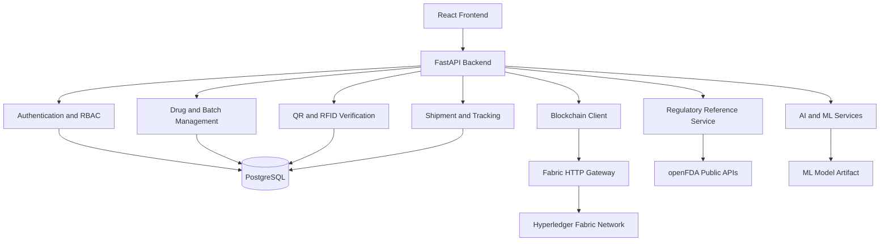

# PharmaVerse AI
### Intelligent Pharmaceutical Traceability & Anti-Counterfeit Platform


PharmaVerse AI is an intelligent pharmaceutical supply-chain traceability and anti-counterfeit platform. It combines QR and RFID identity verification, database-backed tracking, optional Hyperledger Fabric integration, environmental anomaly detection, machine-learning risk assessment, and regulatory reference information.

The platform is designed to improve transparency, product authentication, and accountability across pharmaceutical supply-chain participants, including manufacturers, transporters, distributors, pharmacies, and regulators.

> **Project status:** Academic and research project. IoT telemetry is simulated, machine-learning predictions are experimental, and blockchain functionality requires a separately configured Fabric environment. The platform is not a certified pharmaceutical compliance or medical decision-making system.

---

## Table of Contents

1. [Project Overview](#1-project-overview)
2. [Problem Statement](#2-problem-statement)
3. [Objectives](#3-objectives)
4. [Key Features](#4-key-features)
5. [System Architecture](#5-system-architecture)
6. [Technology Stack](#6-technology-stack)
7. [Repository Structure](#7-repository-structure)
8. [Prerequisites](#8-prerequisites)
9. [Installation and Setup](#9-installation-and-setup)
10. [Running the Application](#10-running-the-application)
11. [Application URLs](#11-application-urls)
12. [API Overview](#12-api-overview)
13. [AI and Machine Learning](#13-ai-and-machine-learning)
14. [Blockchain Integration](#14-blockchain-integration)
15. [Telemetry Simulation](#15-telemetry-simulation)
16. [Testing](#16-testing)
17. [Troubleshooting](#17-troubleshooting)
18. [Security Considerations](#18-security-considerations)
19. [Limitations and Future Enhancements](#19-limitations-and-future-enhancements)
20. [Acknowledgements](#20-acknowledgements)

---

## 1. Project Overview

Pharmaceutical supply chains face several challenges:

- Counterfeit and unauthorized pharmaceutical products.
- Limited visibility into product movement and custody transfers.
- Inadequate monitoring of temperature and humidity during transportation.
- Difficulty maintaining reliable, end-to-end audit trails.
- Delayed identification of suspicious supply-chain activities.

PharmaVerse AI addresses these challenges through a layered architecture.

### Platform components

- **Operational database:** PostgreSQL stores pharmaceutical records, batches, identifiers, shipments, and tracking information.
- **Identity verification:** QR and RFID identifiers provide two complementary ways to verify product identity.
- **Blockchain integration:** Hyperledger Fabric can provide an additional tamper-evident ledger when the network is configured and available.
- **Anomaly detection:** Rule-based checks identify suspicious identity, environmental, and logistics events.
- **Machine learning:** A Random Forest model provides experimental statistical risk predictions.
- **Regulatory reference:** openFDA public APIs provide supplementary pharmaceutical reference information.
- **Role-based access:** Access is organized around supply-chain responsibilities.

## 2. Problem Statement

### Counterfeit pharmaceuticals

Traditional product identification can be vulnerable to copied or reused identifiers. A verification system that checks multiple identifiers against registered records can help identify inconsistencies.

### Supply-chain transparency

Pharmaceutical products pass through multiple organizations. Without reliable tracking, it can be difficult to establish where a product has been and who was responsible for it.

### Cold-chain monitoring

Certain pharmaceutical products require controlled environmental conditions. Temperature and humidity excursions can compromise product quality.

### Fragmented audit trails

Records maintained by separate participants can make it difficult to reconstruct a product's complete history.

PharmaVerse AI brings these activities into a centralized application with optional distributed-ledger integration.

## 3. Objectives

1. Maintain traceable pharmaceutical batch and shipment records.
2. Verify product identities using paired QR and RFID identifiers.
3. Record shipment movement and custody changes.
4. Identify suspicious activities and environmental excursions.
5. Provide risk assessments using deterministic rules and experimental ML models.
6. Offer role-based interfaces for different supply-chain participants.
7. Support additional ledger-based verification through Hyperledger Fabric.

## 4. Key Features

| Feature | Description |
|---|---|
| Authentication | User login and role-based access control |
| Drug management | Pharmaceutical formulation and product records |
| Batch management | Manufacturing batch registration and tracking |
| QR identification | QR code generation and verification |
| RFID identification | RFID identifier registration and verification |
| Dual verification | Comparison of QR and RFID identity records |
| Shipment tracking | Shipment creation, movement, and delivery records |
| Custody management | Tracking of supply-chain responsibility transfers |
| AI anomaly detection | Rule-based analysis of suspicious events |
| ML risk assessment | Statistical risk prediction using a trained model |
| Regulatory reference | openFDA public reference integration |
| Telemetry simulation | Simulated environmental and logistics events |
| Blockchain integration | Optional Hyperledger Fabric connectivity |
| Dashboards | Role-oriented views and operational summaries |

### User roles

The application is designed around the following roles:

- **Admin:** Platform administration and user management.
- **Regulator:** Oversight, compliance monitoring, and anomaly review.
- **Manufacturer:** Drug and batch registration.
- **Transporter:** Shipment movement and telemetry updates.
- **Distributor:** Receiving, storage, and custody transfers.
- **Pharmacy:** Product verification and dispensing checks.

Actual permissions are determined by the backend authorization rules.

## 5. System Architecture

The application follows a layered architecture.



### Architecture layers

**Presentation layer**

React provides the web interface, dashboards, forms, and scanning functionality.

**Application layer**

FastAPI exposes REST endpoints and coordinates authentication, business logic, verification, and analytics.

**Persistence layer**

PostgreSQL stores operational application data.

**Intelligence layer**

Rule-based analysis and machine-learning inference evaluate suspicious events and risk indicators.

**Distributed-ledger layer**

The optional Fabric integration supports ledger transactions and queries when a compatible network is running.

**External services**

The regulatory reference service communicates with openFDA public APIs.

## 6. Technology Stack

| Layer | Technologies |
|---|---|
| Backend | Python, FastAPI, Uvicorn |
| Frontend | React, JavaScript, JSX |
| Frontend tooling | Vite |
| Styling | Tailwind CSS |
| Database | PostgreSQL |
| ORM | SQLAlchemy |
| Migrations | Alembic |
| API validation | Pydantic |
| Authentication | JWT and password hashing |
| HTTP communication | Axios |
| QR generation | qrcode.react |
| QR scanning | @zxing/browser |
| Charts | Recharts |
| AI/ML | scikit-learn, Pandas, NumPy |
| Model serialization | Joblib |
| Blockchain | Hyperledger Fabric |
| Gateway | Node.js |
| External reference | openFDA API |

For exact dependency versions, refer to `requirements.txt` and the relevant `package.json` files.

## 7. Repository Structure

The following is the intended high-level project organization. Individual files may differ depending on the current implementation.

```text
pharmaverse-ai/
│
├── backend/
│   ├── alembic/
│   │   └── versions/
│   ├── app/
│   │   ├── ai/
│   │   ├── api/
│   │   │   └── routes/
│   │   ├── blockchain/
│   │   ├── core/
│   │   ├── database/
│   │   ├── ml/
│   │   ├── models/
│   │   ├── schemas/
│   │   ├── services/
│   │   ├── simulation/
│   │   └── main.py
│   ├── scripts/
│   ├── tests/
│   ├── requirements.txt
│   ├── alembic.ini
│   └── .env.example
│
├── frontend/
│   ├── public/
│   ├── src/
│   │   ├── assets/
│   │   ├── components/
│   │   ├── pages/
│   │   ├── services/
│   │   ├── utils/
│   │   ├── App.jsx
│   │   └── main.jsx
│   ├── package.json
│   └── .env.example
│
├── blockchain/
│   ├── chaincode/
│   │   └── pharmaverse/
│   ├── gateway/
│   └── crypto/
│
├── data/
│   └── models/
│
├── scripts/
├── simulator/
└── README.md
```

**Important:** Blockchain certificates, private keys, local environment files, and other sensitive materials should not be committed to version control.

## 8. Prerequisites

Install the following software before starting the project.

| Software | Recommended requirement | Purpose |
|---|---|---|
| Python | 3.11 or compatible project version | Backend and ML |
| Node.js | Compatible LTS version | Frontend and gateway |
| npm | Included with Node.js | JavaScript dependencies |
| PostgreSQL | Supported project version | Database |
| Git | Recent version | Source control |
| Docker Desktop | Optional | Fabric network |

Hyperledger Fabric and Docker are optional for standard frontend and backend development. They are required only when testing the blockchain integration.

## 9. Installation and Setup

The following commands use Windows PowerShell. Run them from the project root unless otherwise specified.

### 9.1 Clone or open the project

If cloning from a Git repository:

```powershell
git clone <YOUR_REPOSITORY_URL>
cd pharmaverse-ai
```

If the project is already on your computer, open PowerShell in the existing project directory.

### 9.2 Set up PostgreSQL

Ensure PostgreSQL is installed and its database service is running.

Check whether port 5432 is available:

```powershell
Test-NetConnection -ComputerName 127.0.0.1 -Port 5432
```

Create the application database using pgAdmin or `psql`:

```sql
CREATE DATABASE pharmaverse;
```

Use the PostgreSQL username and password configured on your own machine.

### 9.3 Set up the backend

Open a terminal in the project root:

```powershell
cd backend
```

Create a virtual environment:

```powershell
python -m venv venv
```

Activate it:

```powershell
.\venv\Scripts\Activate.ps1
```

Install dependencies:

```powershell
python -m pip install -r requirements.txt
```

Create the backend environment file:

```powershell
Copy-Item .env.example .env
```

Edit `backend/.env` and configure the database connection and required application settings.

**Never commit `.env` files or disclose passwords, JWT secrets, or service credentials.**

### 9.4 Configure database migrations

With the virtual environment activated and the backend environment configured, run:

```powershell
alembic upgrade head
```

This applies the available database migrations.

### 9.5 Optional demo data

If the repository contains the demo seeding script, run it from the backend directory:

```powershell
python scripts/seed_demo_data.py seed
```

This initializes the demo records supported by the script.

Demo user accounts and authentication credentials should be provisioned through the application's supported registration or administrative setup process. No default username or password is published in this README.

### 9.6 Set up the frontend

Open a second terminal:

```powershell
cd frontend
```

Install dependencies:

```powershell
npm.cmd install
```

Create the frontend environment file:

```powershell
Copy-Item .env.example .env
```

Configure the API base URL in `frontend/.env` to match the backend:

```env
VITE_API_BASE_URL=http://localhost:8001/api
```

Use the actual API prefix and port configured by the backend if they differ.

## 10. Running the Application

Start the components in separate terminals.

### Terminal 1: Backend

```powershell
cd backend
.\venv\Scripts\Activate.ps1
uvicorn app.main:app --host 127.0.0.1 --port 8001 --reload
```

The backend should become available at:

```text
http://127.0.0.1:8001
```

### Terminal 2: Frontend

```powershell
cd frontend
npm.cmd run dev
```

The Vite development server should display its local URL in the terminal. The default development address is generally:

```text
http://localhost:5173
```

### Terminal 3: Optional blockchain gateway

Start the Fabric network and gateway only after configuring the required certificates, network endpoints, channel, chaincode, and service credentials.

The gateway startup command depends on the scripts and configuration supplied in `blockchain/gateway`.

Do not assume that the blockchain network is running simply because the backend and frontend are running.

## 11. Application URLs

When using the default development ports:

| Service | URL |
|---|---|
| Frontend | http://localhost:5173 |
| Backend | http://127.0.0.1:8001 |
| Swagger API documentation | http://127.0.0.1:8001/docs |
| OpenAPI specification | http://127.0.0.1:8001/openapi.json |
| Backend health check | http://127.0.0.1:8001/api/health |

The health-check route should be confirmed against the routes registered by the current backend.

## 12. API Overview

The FastAPI backend provides REST APIs for the application's main operations.

The interactive Swagger documentation is available at:

```text
http://127.0.0.1:8001/docs
```

The following are the principal API areas:

| API area | Purpose |
|---|---|
| `/api/auth` | Registration, login, and user information |
| `/api/drugs` | Drug catalog management |
| `/api/batches` | Manufacturing batch management |
| `/api/qr` | QR identifier management |
| `/api/rfid` | RFID identifier management |
| `/api/verification` | Product identity verification |
| `/api/shipments` | Shipment management and tracking |
| `/api/dashboard` | Dashboard statistics |
| `/api/admin` | Administrative operations |
| `/api/audit` | Batch audit information |
| `/api/ai` | Anomaly analysis and regulatory reference |
| `/api/ml` | Machine-learning status and predictions |
| `/api/simulation` | Telemetry simulation |
| `/api/blockchain` | Blockchain-related operations |

The exact HTTP methods, request fields, permissions, and response structures are defined by the backend's OpenAPI specification. Refer to `/docs` rather than assuming every route is enabled in every deployment.

## 13. AI and Machine Learning

PharmaVerse AI uses two complementary approaches to identify potentially suspicious supply-chain activity.

### 13.1 Rule-based anomaly detection

The deterministic analysis layer evaluates incoming data against configured conditions.

Examples include:

- Temperature outside configured product limits.
- Excessive humidity.
- Unusual shipment delays.
- Suspicious route deviations.
- Repeated or mismatched identifiers.
- Unauthorized custody changes.
- Inconsistent event timestamps.

The system can produce anomaly information and risk indicators based on the configured rules.

### 13.2 Machine-learning risk assessment

The ML component uses a scikit-learn Random Forest classifier when a compatible trained model artifact is available.

Potential model inputs include:

- Number of detected anomalies.
- Number of high-severity anomalies.
- Identity-related anomaly counts.
- Sensor-related anomaly counts.

Model availability and evaluation metrics depend on the model artifact and training process included in the repository.

**Important:** ML predictions are experimental risk indicators. They do not independently establish that a pharmaceutical product is counterfeit or safe.

### 13.3 Regulatory reference integration

The platform can retrieve supplementary pharmaceutical information from openFDA public APIs.

Reference sources may include:

- National Drug Code (NDC) directory.
- Drug enforcement reports.
- Drug shortage information.

External API availability, response limits, and data freshness depend on openFDA.

Regulatory reference information should be treated as supplementary data, not as a replacement for official regulatory verification.

## 14. Blockchain Integration

PharmaVerse AI includes an optional integration layer for Hyperledger Fabric.

### Intended capabilities

- Recording pharmaceutical drug and batch information.
- Recording custody transfers.
- Maintaining a ledger history of relevant events.
- Querying ledger records during verification.
- Supporting tamper-evident audit operations.

### Components

| Component | Responsibility |
|---|---|
| Fabric network | Distributed-ledger infrastructure |
| Peer organizations | Ledger participation and transaction endorsement |
| Ordering service | Transaction ordering |
| Chaincode | Application-specific ledger operations |
| Node.js gateway | HTTP-to-Fabric communication |
| FastAPI client | Backend integration with the gateway |

### Running blockchain functionality

Blockchain operation requires a separately configured Fabric network.

Before enabling it, ensure that:

1. Docker and the Fabric network are running.
2. Required peer and orderer endpoints are reachable.
3. The channel and chaincode are installed and available.
4. Valid certificates and private keys are configured securely.
5. The gateway and backend use matching service authentication settings.
6. The configured gateway URL is reachable from the backend.

Keep Fabric disabled when these requirements have not been satisfied.

A successful database verification is not equivalent to a successful blockchain verification. The application should distinguish between an authentic local record and a ledger check that could not be completed.

## 15. Telemetry Simulation

The project includes simulated telemetry for testing supply-chain conditions without physical IoT devices.

Potential scenarios include:

| Scenario | Purpose |
|---|---|
| Normal | Simulates standard shipment conditions |
| Temperature excursion | Simulates temperature violations |
| Humidity excursion | Simulates excessive humidity |
| Route deviation | Simulates unexpected transportation routes |
| Delayed shipment | Simulates delivery delays |
| RFID mismatch | Simulates an incorrect RFID identity |
| QR mismatch | Simulates an incorrect QR identity |
| Unauthorized transfer | Simulates an invalid custody change |
| Combined high risk | Combines multiple suspicious conditions |

If the standalone simulator is available, inspect its command-line options:

```powershell
python simulator/cli.py --help
```

Use the options displayed by the script to list or execute supported scenarios.

Simulated sensor readings are for development and demonstration, not actual pharmaceutical environmental monitoring.

## 16. Testing

Testing should be performed separately for the backend, frontend, gateway, and chaincode where applicable.

### Backend tests

From the backend directory, activate the virtual environment and run:

```powershell
pytest -v
```

### Frontend tests

From the frontend directory, use the test command defined in `package.json`.

For example, if the project defines an npm test script:

```powershell
npm.cmd test
```

### Frontend lint and build

```powershell
npm.cmd run lint
npm.cmd run build
```

### Blockchain gateway tests

If the gateway package defines a test script:

```powershell
npm.cmd test
```

### Chaincode tests

If the chaincode package defines a test script:

```powershell
npm.cmd test
```

Test commands and totals depend on the current repository configuration. Test results should be reported only after running the corresponding commands successfully.

## 17. Troubleshooting

### PostgreSQL connection failure

**Possible causes:**
- PostgreSQL service is stopped.
- Incorrect database password.
- Incorrect database name.
- Incorrect connection string.
- PostgreSQL is listening on another port.

**What to check:**

```powershell
Test-NetConnection -ComputerName 127.0.0.1 -Port 5432
```

Check the database connection settings in `backend/.env`.

### Backend port already in use

If port 8001 is occupied, identify the process:

```powershell
Get-NetTCPConnection -LocalPort 8001
```

Stop only the process you have identified as safe to terminate, or configure the application to use another available port.

### Python dependency errors

Ensure the virtual environment is activated:

```powershell
.\venv\Scripts\Activate.ps1
```

Then reinstall the project's dependencies:

```powershell
python -m pip install -r requirements.txt
```

### PowerShell blocks npm

Use:

```powershell
npm.cmd install
```

and:

```powershell
npm.cmd run dev
```

This avoids invoking the PowerShell `npm.ps1` script.

### Frontend cannot reach backend

Check:

- Backend startup logs.
- Backend port and API prefix.
- `VITE_API_BASE_URL` in the frontend environment file.
- Backend CORS configuration.
- Whether the frontend and backend are running.

Restart the frontend after changing its environment file.

### Fabric gateway unavailable

Check:

- Docker Desktop status.
- Fabric container status.
- Peer and orderer connectivity.
- Gateway configuration.
- Certificate paths.
- Matching gateway service credentials.
- Backend Fabric configuration.

If Fabric is not configured, keep the integration disabled and use the available non-blockchain functionality.

### Camera scanning does not work

Camera access requires browser permission and a secure browser context. Use localhost during development and allow camera access when prompted.

Manual identifier entry can be used when camera access is unavailable.

## 18. Security Considerations

- Never commit `.env` files, database passwords, JWT secrets, or private keys.
- Use strong, unique secrets for each deployment.
- Store blockchain certificates and private keys securely.
- Use HTTPS in deployed environments.
- Enforce permissions on backend endpoints, not only in frontend navigation.
- Validate user input and API request data.
- Use least-privilege database accounts where practical.
- Do not expose internal gateway credentials to browser clients.
- Avoid publishing real user information or database records in screenshots and demonstrations.
- Use test accounts and synthetic data for academic demonstrations.

## 19. Limitations and Future Enhancements

### Current limitations

- Environmental telemetry may be simulated rather than collected from physical devices.
- Blockchain functionality requires additional network configuration.
- ML predictions depend on the available trained model and dataset.
- openFDA information depends on external service availability.
- The platform is an academic prototype rather than a certified production pharmaceutical tracking system.

### Future enhancements

1. Physical IoT sensor integration using MQTT and hardware gateways.
2. Mobile QR and NFC scanning applications.
3. Stronger cross-organization identity and credential management.
4. Expanded blockchain network deployment.
5. Improved model training with validated real-world datasets.
6. Advanced analytics and supply-chain visualization.
7. Production-grade monitoring, logging, and deployment automation.
8. Additional regulatory integrations for different countries.

## 20. Acknowledgements

PharmaVerse AI is developed as an academic project exploring service-oriented architecture, pharmaceutical traceability, distributed trust, and intelligent supply-chain monitoring.

**Domain:** Service-Oriented Architecture and Distributed Systems

**Technologies:** FastAPI, React, PostgreSQL, Python, scikit-learn, and Hyperledger Fabric.

**Regulatory reference:** U.S. Food and Drug Administration openFDA public APIs.

---

**PharmaVerse AI — Intelligent Traceability. Transparent Supply Chains. Safer Pharmaceutical Distribution.**